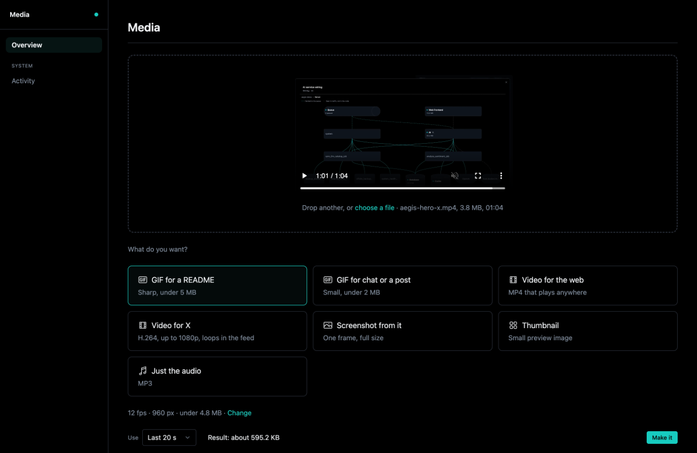
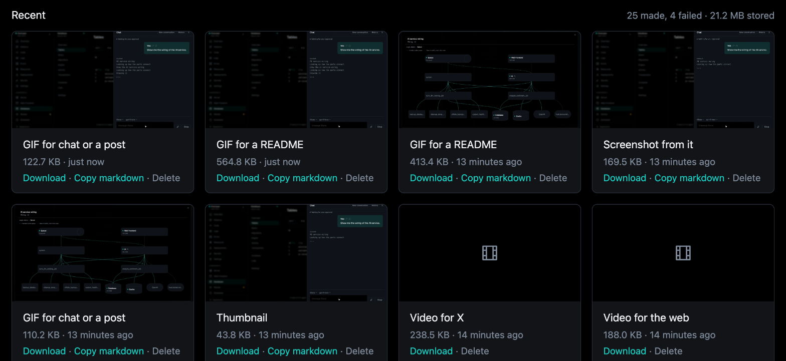
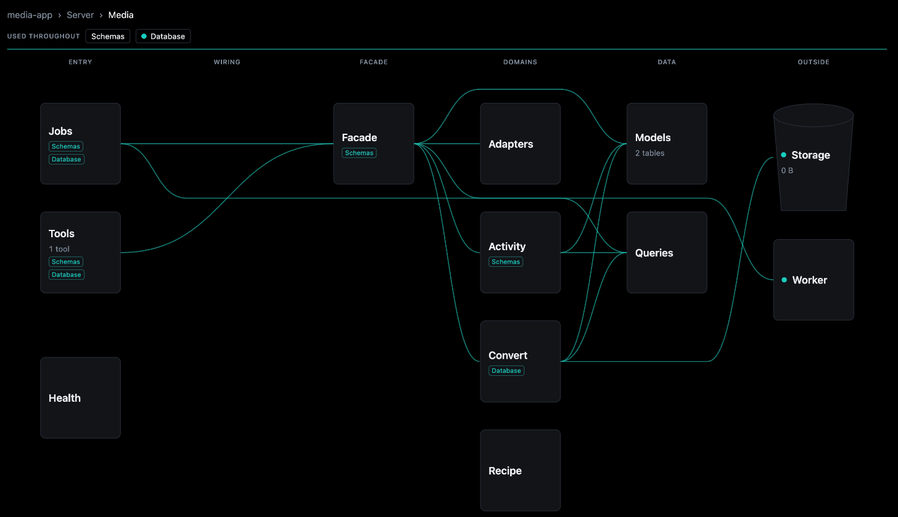

# aegis-stack-media

Media conversion for [Aegis Stack](https://github.com/lbedner/aegis-stack) projects. Drop in a
video, a screen recording or an image, pick what you want back (a GIF for a README, a video for
X, a thumbnail, the audio) and get a link. Every conversion is a row: its profile, its source,
its result, its size. Nothing ends up named `final_v2_actual.gif` on a desktop. Listed in the
[plugin directory](https://aegis-stack.io/plugins/aegis-stack-media).



## What it does

- **Converts by profile, not by flags.** "GIF for a README" means 12 fps, 960 px and under
  5 MB. The profiles are a YAML file, so adding one is a data edit, and it appears in the page,
  the CLI and the agent's tool at once.
- **Keeps a size cap.** A GIF over its `max_bytes` is made again at a smaller width and frame
  rate until it fits, so "under 5 MB" is what you get.
- **Trims.** The whole clip, or its first or last N seconds, per job. A still (a screenshot, a
  thumbnail) is one frame and takes no trim.
- **Reads what ffmpeg cannot.** An animated WebP is decoded with Pillow, frame by frame, and a
  GIF or a WebP is offered what a video is.
- **Shares files safely.** Sources and results go through the stack's storage catalog. The
  store is content-addressed, so two jobs that made the same bytes share one object, and
  deleting one result keeps the file the other still shows.



## How it connects



`aegis add media` renders an ordinary service into the project, wired into the parts the stack
already has:

- **Database.** Two tables in their own `media` Postgres schema (unqualified on SQLite):
  `media_job`, a row per conversion, and `media_profile`, this project's edits to a shipped
  profile. Created by an Alembic migration; a job's keys reference the storage catalog.
- **Object store.** Sources and results live in `app.core.storage`: the filesystem or an S3
  bucket, whichever the stack uses.
- **Worker.** Conversions run on the plugin's own `media` queue, one at a time, in their own
  `worker-media` container with 1 GB, on arq, TaskIQ or Dramatiq, whichever the stack uses. Without a worker they run in the webserver.
- **Agents.** A `media` tool in the app's tool registry, granted to the chat agent and the MCP
  server: it queues a conversion of a stored object and answers with the job.
- **CLI.** A `media` command group in the project CLI.
- **Health and frontends.** A `media` health check, a card and modal on the dashboard, and a
  Media page in the htmx Overseer: Overview to convert and see what was made, Activity for the
  charts and every conversion.

Inside, the page, the CLI, the jobs and the tool go through one facade (`MediaService`) to
three domains: convert (the job), recipe (a profile as ffmpeg arguments, pure) and activity.
The map above is that structure, read from the code.

ffmpeg arrives as a pip dependency (`imageio-ffmpeg` ships a static build): no `apt-get` line,
and the same binary on a laptop, in the worker container and on a VPS.

## Install

Inside an Aegis Stack project (aegis-stack 0.20.0 or later):

```bash
uv pip install aegis-stack-media
aegis plugins list    # media shows as ready
aegis add media
```

The plugin needs the `storage` component; `aegis add` adds `database` first when the project
lacks it. The `worker` component is recommended.

## First conversion

```bash
<project> media profiles
<project> media convert demo.mov --profile readme-gif --last 20
<project> media results
```

`convert` stores the file and queues the job; `--wait` runs it here instead and prints the
link, which is how to run one on a stack without a worker. Or open Overseer > Media and drop
the file on the page.

## Profiles

`<project> media profiles` lists what this project can make, read from
`app/services/media/adapters/profiles.yml`.

A profile is the result, not a list of flags:

```yaml
readme-gif:
  title: GIF for a README
  description: Sharp, under 5 MB
  kind: gif
  fps: 12
  width: 960
  max_bytes: 5000000
```

`kind` picks the recipe, and a setting the kind does not take is refused by name when the
file loads. "Change" on the page saves this project's own settings for a profile
without editing the file.

## Develop

```bash
make install     # uv sync --all-extras
make check       # lint + the spec tests
```

`tests/test_plugin.py` checks the spec contract here. The tests under
`templates/{{ project_slug }}/tests/` ship into the generated project and run against the real
service there, including a layout test that holds the plugin to the host project's structure.
Open work is in [`docs/tickets/`](docs/tickets/README.md), each ticket with what "done" means.

## License

MIT.
